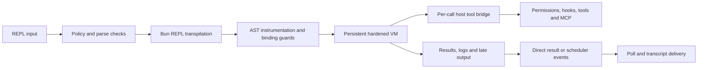

# Source-backed Code Mode behavior

This supersedes the architectural inferences in the original home-directory extracts. It covers locally shipped Claude Code 2.1.329 and 2.1.330. **Recovered** means the implementation is present; **tested** means the specified path was executed with controlled host adapters; **host-dependent** means full behavior still relies on the Claude runtime or remote services. See [COVERAGE.md](COVERAGE.md).

## Architecture and execution

Code Mode exposes an execution tool and an event-polling tool to the model. Other tools are callable from JavaScript through globals and a tool registry. The supplied request capture additionally contains an advisor tool; that capture is evidence for one session, not a universal list.

The real input schema has `code`, optional `description`, and optional `timeout`. `description` supplies UI text; it is not a verified explanation of the script. The schema's timeout is a script-own-time allowance, excluding host tool waits. Input/output schemas are recovered in the [330 core](versions/2.1.330/formatted/chunk-v7j43e2p.js#L10582); the original exact captured input schema remains in `evidence/inputs/code-mode-tools.json`.

Scripts share one VM per session context. Top-level declarations are preserved through Bun's private `replMode` transpiler, which emits an execution wrapper and persistent bindings; top-level await is supported. Source is checked for imports/require, transpiled, instrumented, checked for protected global writes, and marked for tracking variables left unset by interrupted scripts. The final expression and explicit logs form the visible output.

State does not survive a restart/resume/fork/wake that creates a new context. There is an explicit new-context notice. A poisoned context can also be discarded; the first failed call explains that earlier bindings were lost. A context release clears its timers.

The system Bun found here is 1.2.9. Passing `{replMode:true}` to its transpiler does not produce the wrapper expected by the recovered runtime. Consequently the test harness starts parser/instrumentation tests at the post-transpilation wrapper boundary. It does not substitute the system Bun for the shipped runtime.

## Scheduling and event delivery

The [330 scheduler](versions/2.1.330/formatted/chunk-yaw6xb6n.js) retains per-context pending scripts, active abort controllers, a result-delivery chain, late output, tool-progress ticks, transcript-rewind state and outstanding-work counters.

Scripts begin FIFO. While attached, a script holds up the next one; detaching allows later scripts to start while it continues. This is a shared VM, so detached scripts can race on shared bindings. Up to eight scripts may be queued/running before further dispatch is refused. Delivery is chained separately from execution.

Depending on mode and feature configuration, the tool can return a completed result within a settle window or an early `(dispatched #N)` receipt. A receipt is not a failure or an invitation to repeat the call. Completion then arrives through a `repl-eval` event. `repl-status` reports outstanding work. Late output remains attributed to its original evaluation. This corrects the earlier spec's unconditional claim that every asynchronous REPL call returns immediately: the source contains multiple delivery paths and prompt variants.

Abort paths distinguish queued scripts that never ran, active scripts, late work, a person's interruption, task-stop, a script's abort, and a permission refusal. A queued script can be cancelled without running it. A refusal can cancel queued scripts behind the refused call. Ledger states exposed through `running()` are `waiting`, `running`, `detached`, and `late`.

The polling/transcript integration also supports status lines, progress batches, resumption, lost evaluations after process exit, notifications and cache-lifetime waits. Local scheduler behavior is tested; the complete model/transcript/poll transport remains host-dependent.

## Global API

The authoritative recovered declarations are [core Bash async](versions/2.1.330/assets/core.bash.async.d.ts-6ecbb55e.txt), [core PowerShell async](versions/2.1.330/assets/core.powershell.async.d.ts-550adb89.txt), [contexts async](versions/2.1.330/assets/team.async.d.ts-t0nj35ss.txt), and [external tools](versions/2.1.330/assets/tools-external.d.ts-f7115890.txt). Sync variants are also recovered. The actual description chooses and combines declarations based on session configuration.

| Surface | Behavior recovered |
|---|---|
| `$` | Tagged template or command string; returns a chainable shell promise. |
| `$.escape` | Quotes one argument for the current shell. |
| `$.ShellError` | Typed command failure with output, exit and background metadata. |
| `edit` | Exact replacement, single or ordered batch; `{all, soft}` options. |
| `write` | Whole-file write through the host; resolves byte count. |
| `file` | Lazy, frozen reader handle: `name`, `text`, `json`, `lines`, `exists`, `slice`. |
| `sleep` | Host-owned timer promise, cancelled when its owning script cannot wait further. |
| `log`, `self.log` | Output delivered to the model. |
| `console` | Persistent bounded ring: `log/info/debug/warn/error`, `tail`, `buffer`, `dropped`. |
| `preview` | Compact display, including a saved-output header when available. |
| `running` | Frozen task snapshots with identity, state, age, self flag and `abort`. |
| `tools`, bare tool globals | Registry of tools actually available to that context; `tools.list()`. |
| `searchTools` | Discovery results containing name, summary and input type. |
| `describeTool` | Description and full input schema, or error. |
| timers/base64 | Host timers and cancellation, `atob` and `btoa`. |
| `spawnContext`, `releaseContext`, `listContexts`, `contexts` | Context lifecycle and handles, conditionally installed. |

`tools` is a read-only proxy. The registry filters tools unavailable to a subagent or session; a type declaration alone is not proof that a tool can run. Built-in tool failures can resolve `{error}`, whereas MCP failures are surfaced as exceptions with parsed details. Inputs and results cross the VM boundary through sanitizers.

### Shell behavior

The [original generated shell helper](versions/2.1.330/assets/shell.prelude.js-77bab478.txt) is recovered in full and is identical in both versions.

String interpolations are shell-quoted automatically. Arrays expand to separate arguments only where the template appears to allow multiple words. Multi-item arrays in a word or redirect target, empty redirect arrays, and null/undefined interpolations are refused before calling the host. Numbers, booleans and BigInts have their own conversion path. Template raw text preserves shell escapes except the documented escapes for backticks and `${`.

`{raw: text}` does **not** mean every raw-shaped object can bypass quoting. Source instrumentation marks a one-key raw object literal; a host-backed check verifies the unchanged raw property. A feature gate can disable that provenance requirement. Parsed JSON or a subsequently changed raw property fails the active check. This resolves the purpose of the previously unexplained raw marks.

PowerShell has a separate quoting path. It doubles ASCII single quotes and refuses typographic quote characters U+2018 through U+201F, which the PowerShell tokenizer could interpret as delimiters. `.env()` validates ASCII variable names before inserting their keys; values and `.cwd()` are quoted.

Modifiers are `.nothrow()`, `.throws(bool)`, `.quiet()`, `.timeout(ms)`, `.cwd(dir)`, `.env(object)`. In the helper, `.quiet()` is a chain-compatible no-op. Nonzero exits throw unless disabled, unless the host attached an outcome note, or unless the command is still running in the background.

The host recognizes outcome exits such as `rg` no-match; this recognition is not implemented by the generated helper. Likewise execution, permissions, exit detection, spill files, timeout-to-background, and command termination are host responsibilities.

Immediate `.text()/.lines()/.json()` calls on the promise request full output from the host. Calling the reader after awaiting a `ShellOutput` reads its inline stdout instead. Both readers reject a background result as unfinished. `whole`, `truncated`, `file`, `bytes`, `withheld`, partial-output notes and an unsandboxed-retry record preserve output provenance. `ShellOutput` stringification returns its display output, not just stdout.

### File behavior

The [original file helper](versions/2.1.330/assets/file.prelude.js-rv1w439g.txt) is also identical in both versions. Batch edit preflight simulates replacements **in order**, so a later anchor can match text produced by an earlier replacement. Missing, empty or ambiguous anchors fail before the first host edit. Subsequent host failures can leave earlier edits applied; the batch is not a transactional filesystem write.

Replacement text is literal, including `$&` and `$1`. `{all:true}` replaces every non-overlapping match. `{soft:true}` returns `{ok:false,replacements,error}`. Old and new text that are identical are skipped **without checking that the old text exists**, with an output note. Objects, arrays, functions and missing text are rejected rather than accidentally written as object descriptions.

`file(path)` does no read until a method is called. `slice` delegates 1-based offsets to the host. `exists()` distinguishes missing/present probes from permission or other errors. `lines()` preserves a trailing empty line after a trailing newline. Writes return host-reported byte counts.

### Additional context API

The earlier capture did not cover this [generated context helper](versions/2.1.330/assets/team.prelude.js-jyv8vsvj.txt). It is shipped in both versions, with conditional installation in the runtime; shipping it does not prove it is enabled in every session.

`spawnContext({name,role?,initialPrompt,fork?})` uses the normal Agent host path. `releaseContext` stops a spawned context. Names are never reused within the tracked context map. The helper's declaration does not advertise model/schema selection; it specifically rejects either option combined with `fork:true`.

`contexts.<name>` is a stable handle with live status/role/parent, `state.lastText`, `state.cost`, `tail(n)`, `result()`, and `log(text)`. A report that must first be cleared can prevent reading `lastText` or obtaining a result. Context handles are tested using host fixtures; no actual context was spawned and no message was sent during recovery.

## Output and boundary handling

The host emits selected result parts and logs, escapes display markup, performs head/tail truncation, and appends notes about refused calls, still-running calls, unstarted calls, cancelled timers, images, PDFs, failed pages, notifications and tools used. Original values and file content remain unchanged by display escaping.

Promise-valued top-level result fields are resolved; promises coerced to strings trigger a specific error. This is not a general promise-lint proof: the source installs Promise string-coercion handling and tracks host calls, rather than statically proving that every promise was awaited.

Result schemas include `asyncDispatched`, `neverRan`, `stoppedBy`, `evalId`, `ms`, `late`, `plainErrorLine`, image/document metadata, refusals, notifications, `toolsUsed` and `carriedMarkers`. Provenance is carried across scripts that share bindings. Recovered code confirms the mechanism; backend interpretation is outside this extraction.

PostToolUse rewrites are accepted only if they match the REPL output schema. Invalid rewrites are ignored with diagnostic text. Late output is batched through that pipeline too.

## Recovered limits

These are the locally shipped defaults, not guarantees for all future builds or remotely configured sessions.

| Limit | Recovered value | Evidence |
|---|---:|---|
| Script own-time default | 30,000 ms | 330 input schema and core |
| Script own-time maximum | 600,000 ms | schema description / runtime validation |
| Synchronous turn wall clock | 30,000 ms | [configuration](versions/2.1.330/formatted/chunk-w50zedgp.js#L340) |
| Steps per turn | 300,000,000 | [instrumentation config](versions/2.1.330/formatted/chunk-zg2mw0h6.js#L18) |
| Maximum step stride | 64 | same source; clock read at stride boundaries |
| Slow-stride threshold | 5 ms | same source |
| Memory allowance | `min(4 GiB, max(1 GiB, min(totalmem, constrainedMemory-or-infinity)/4))` | [configuration](versions/2.1.330/formatted/chunk-w50zedgp.js#L348) |
| Memory-check spacing | 100 ms | same configuration; actual check also considers baseline, RSS, heap and GC |
| Leftover-code clock | 250 ms | same configuration; checked only on the leftover path |
| Tool calls per script | 50,000 | [configuration](versions/2.1.330/formatted/chunk-w50zedgp.js#L377) |
| Unsettled scripts per context | 8 | [scheduler](versions/2.1.330/formatted/chunk-yaw6xb6n.js#L17) |
| Default settle/detach window | 30,000 ms | configuration; chosen paths can settle differently |
| Maximum syntax nesting | 500 | instrumentation module |
| Parse-cost ceiling | 2,000,000 weighted units | instrumentation module; not simply source bytes |
| Console ring | 2,000 entries / 1 MiB accounting | [330 core](versions/2.1.330/formatted/chunk-v7j43e2p.js#L3931) |
| Script log accumulation | 50 MiB accounting | [330 core](versions/2.1.330/formatted/chunk-v7j43e2p.js#L3969) |
| Result display part | about 30,000 characters | configuration and renderer |
| Full text Read allowance | 256 MiB | host Read wrapper |
| Saved shell output | first 64 MiB | generated shell declaration and host output handling |
| Images / failed-page notes / PDFs | 8 / 8 / 4 per result | [330 result collectors](versions/2.1.330/formatted/chunk-v7j43e2p.js#L11178) |
| Tool watchdog | `ceil(nativeTimeout*1.5)+5000ms`, plus 30,000ms for selected tools | [watchdog](versions/2.1.330/formatted/chunk-v7j43e2p.js#L13558) |

Many counters named bytes actually account JavaScript string length in the relevant code; the report avoids asserting byte-accurate Unicode memory usage for those counters. The memory allowance is not a simple absolute process-RSS ceiling. Resource probes use small substituted budgets and memory/clock signals to verify the recovered stop paths without allocating gigabytes.

Shell waits default to 600,000 ms, with up to 7,200,000 ms in supported long-running paths. At a command's own timeout the host may background it; `sleep` and sessions with background tasks disabled are exceptions. This is separate from the execution tool's own-time budget and its host hard-clock limits.

## Hardening, permissions and activation

Hardening includes removing engine/debug/realm/weak-reference/shared-memory globals, restricting dynamic code generation, freezing intrinsics with property-override accommodations, capturing original built-ins, wrapping boundary functions, filtering dangerous values/proxies/context globals, and keeping stop checks in closures. Function stringification hides injected markers. These mechanisms are recovered; the probe harness is not a security certification of them.

The native implementation recognizes a VM context global through Bun's `ant.isVmContextGlobal` support. The [context-global guard](versions/2.1.330/formatted/chunk-kbr9bg9m.js) and engine self-check fail closed on unsupported paths. Standard Node VM plus ad hoc stubs does not reproduce those guarantees.

The normal host permission/rule/hook pipeline remains around inner calls. Auto review also evaluates scripts before execution and has refusal paths for unsupported Unicode-escape forms and hook-modified calls. The complete policy/classifier service is not contained in the local feature module. A reviewer description is not checked against the script.

Activation is controlled by environment/settings, account/provider/model, managed policy, runtime support, permissions and other session features. The [330 activation code](versions/2.1.330/formatted/chunk-37g0b5az.js) also has an explicitly gated SDK/headless path, so the old blanket claim that Code Mode cannot work headlessly is too broad for this binary. This is source-confirmed, not an exercised configuration. The opt-in/restart flow records caveat acceptance and can restart out of the mode when conditions change. Browser/computer-use restrictions are integrated with that state.

## Version differences and remaining boundaries

All four generated helper implementations are identical. The 330 core is reorganized: call state becomes a class, multiple runtime services move, the parser/instrumentation code is split out, a different shipped parser replaces the previous Acorn path, and `__replEnter` is newly reserved. The [structural map](evidence/core-version-map.json) finds 428 uniquely matching top-level AST shapes after identifier normalization. That is a navigation aid, not a proof that all other declarations changed semantically or that matched declarations have equivalent dependencies.

No `$.model.classify` API is installed by the recovered shell prelude or advertised by the recovered core declarations. The earlier nearby string is insufficient evidence to include that as a Code Mode feature.

The complete shipped JS archive is available, including all resolved dependencies and assets. Exact original TypeScript, original symbol names, server-side policy/model behavior, the private native runtime implementation, and live end-to-end parity are outside what this extraction establishes. These boundaries must remain explicit when using this material to implement another agent.
