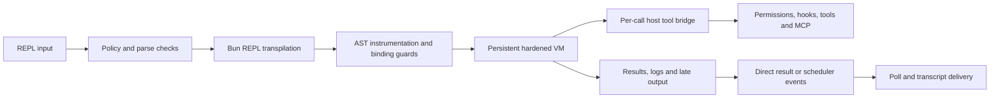

# Code Mode functionality specification

This documents the full locally recovered behavior of Claude Code **2.1.329** and **2.1.330**, reviewed on **2026-11-21** and published on **2026-11-24**. It expands the earlier [REPL prompt extract](codemode.md) with runtime behavior, API contracts, resource limits, scheduling, permissions, context management, verification coverage, and implementation acceptance criteria.

**Recovered** means the implementation is present in the shipped binary. **Tested** means the path was executed with controlled host adapters. **Host-dependent** means behavior still relies on the Claude runtime or remote services. Recovery of the embedded JavaScript does not establish a standalone implementation with end-to-end parity.

This specification is self-contained. The [complete extraction and test harness](code-mode-recovery/README.md) are published alongside this document. Evidence identifiers link to the [recovery inventory](#evidence-inventory). The original prompt extract remains a historical record; unconditional claims in it should be read alongside the version-specific behavior here.

## Architecture and execution

Code Mode exposes an execution tool and an event-polling tool to the model. Other tools are callable from JavaScript through globals and a tool registry. The supplied request capture additionally contains an advisor tool; that capture is evidence for one session, not a universal list.



The real input schema has `code`, optional `description`, and optional `timeout`. `description` supplies UI text; it is not a verified explanation of the script. The schema's timeout is a script-own-time allowance, excluding host tool waits. Input/output schemas are recovered in the [330 core (E1)](#evidence-inventory); the original exact captured input schema is retained in the local recovery record `evidence/inputs/code-mode-tools.json`.

Scripts share one VM per session context. Top-level declarations are preserved through Bun's private `replMode` transpiler, which emits an execution wrapper and persistent bindings; top-level await is supported. Source is checked for imports/require, transpiled, instrumented, checked for protected global writes, and marked for tracking variables left unset by interrupted scripts. The final expression and explicit logs form the visible output.

State does not survive a restart/resume/fork/wake that creates a new context. There is an explicit new-context notice. A poisoned context can also be discarded; the first failed call explains that earlier bindings were lost. A context release clears its timers.

The system Bun present during the 2026-11-21 review was 1.2.9. Passing `{replMode:true}` to its transpiler does not produce the wrapper expected by the recovered runtime. Consequently the test harness starts parser/instrumentation tests at the post-transpilation wrapper boundary. It does not substitute the system Bun for the shipped runtime.

## Execution and event contracts

The execution tool accepts this object; additional properties are not accepted by the captured schema:

```ts
type ExecutionInput = {
  code: string;
  description?: string;
  timeout?: number;
};
```

`code` is always JavaScript. `description` is a concise action summary for the user-facing tool card. `timeout` is in milliseconds and applies to the script's own time, not accumulated host-tool waits. The polling tool takes an empty input object and delivers pending events or waits according to host/session policy.

The runtime's output record supports the following fields. This is the host record underlying the rendered result, not a promise that every field appears in every tool result or session mode.

| Field | Meaning |
|---|---|
| `code` | Executed source text. |
| `result` | Optional selected return value. |
| `stdout`, `stderr` | Script log output and error/diagnostic output. |
| `error` | Optional execution or host error. |
| `stoppedBy` | `user` or `refusal` for those interruption paths. |
| `asyncDispatched` | Receipt-only output, cap refusal, or cancellation before execution. |
| `neverRan` | `person` or `other` when cancelled before running. |
| `evalId`, `ms`, `late` | Evaluation identity, elapsed time, and late-output attribution. |
| `plainErrorLine` | Internal concise display text and the diagnostic it replaces. |
| `keptByTurnAbort` | Internal transcript-recovery indication for supported early-return paths. |
| `images`, `imagesOmitted`, `imagesRefused` | Image content and omission/refusal metadata. |
| `imagePagesFailed`, `imagePagesFailedOmitted` | Failed-page notes and overflow accounting. |
| `documents`, `documentsOmitted` | PDF content and omission accounting. |
| `notifications` | Whole text returned by notification reads. |
| `refusedCalls` | Collected inner-call refusal text on supported non-throwing result paths. |
| `toolsUsed` | Newly used/discovered tool names needed by the conversation's tool context. |
| `carriedMarkers` | Provenance markers carried from tool results and shared context. |

A rendered result may use a `<repl-output>` element, a dispatch receipt, or an event. Events include `repl-eval` for results/logs/errors and `repl-status` for outstanding scripts; event payload formatting has feature-dependent variants. No result from a receipt-only call should be inferred before its completion event arrives. A no-pending-events response does not establish that outstanding background work has finished.

## Scheduling and event delivery

The [330 scheduler (E4)](#evidence-inventory) retains per-context pending scripts, active abort controllers, a result-delivery chain, late output, tool-progress ticks, transcript-rewind state and outstanding-work counters.

Scripts begin FIFO. While attached, a script holds up the next one; detaching allows later scripts to start while it continues. This is a shared VM, so detached scripts can race on shared bindings. Up to eight scripts may be queued/running before further dispatch is refused. Delivery is chained separately from execution.

Depending on mode and feature configuration, the tool can return a completed result within a settle window or an early `(dispatched #N)` receipt. A receipt is not a failure or an invitation to repeat the call. Completion then arrives through a `repl-eval` event. `repl-status` reports outstanding work. Late output remains attributed to its original evaluation. This corrects the earlier spec's unconditional claim that every asynchronous REPL call returns immediately: the source contains multiple delivery paths and prompt variants.

Abort paths distinguish queued scripts that never ran, active scripts, late work, a person's interruption, task-stop, a script's abort, and a permission refusal. A queued script can be cancelled without running it. A refusal can cancel queued scripts behind the refused call. Ledger states exposed through `running()` are `waiting`, `running`, `detached`, and `late`.

The polling/transcript integration also supports status lines, progress batches, resumption, lost evaluations after process exit, notifications and cache-lifetime waits. Local scheduler behavior is tested; the complete model/transcript/poll transport remains host-dependent.

## Global API

The authoritative recovered declarations are [core Bash async (E7)](#evidence-inventory), [core PowerShell async (E8)](#evidence-inventory), [contexts async (E9)](#evidence-inventory), and [external tools (E10)](#evidence-inventory). Sync variants are also recovered. The actual description chooses and combines declarations based on session configuration.

| Surface | Behavior recovered |
|---|---|
| `$` | Tagged template or command string; returns a chainable shell promise. |
| `$.escape` | Quotes one argument for the current shell. |
| `$.ShellError` | Typed command failure with output, exit and background metadata. |
| `edit` | Exact replacement, single or ordered batch; `{all, soft}` options. |
| `write` | Whole-file write through the host; resolves byte count. |
| `file` | Lazy, frozen reader handle: `name`, `text`, `json`, `lines`, `exists`, `slice`. |
| `sleep` | Host-owned timer promise, cancelled when its owning script cannot wait further. |
| `log`, `self.log` | Output delivered to the model. |
| `console` | Persistent bounded ring: `log/info/debug/warn/error`, `tail`, `buffer`, `dropped`. |
| `preview` | Compact display, including a saved-output header when available. |
| `running` | Frozen task snapshots with identity, state, age, self flag and `abort`. |
| `tools`, bare tool globals | Registry of tools actually available to that context; `tools.list()`. |
| `searchTools` | Discovery results containing name, summary and input type. |
| `describeTool` | Description and full input schema, or error. |
| timers/base64 | Host timers and cancellation, `atob` and `btoa`. |
| `spawnContext`, `releaseContext`, `listContexts`, `contexts` | Context lifecycle and handles, conditionally installed. |

`tools` is a read-only proxy. The registry filters tools unavailable to a subagent or session; a type declaration alone is not proof that a tool can run. Built-in tool failures can resolve `{error}`, whereas MCP failures are surfaced as exceptions with parsed details. Inputs and results cross the VM boundary through sanitizers.

### Shell behavior

The [original generated shell helper (E11)](#evidence-inventory) is recovered in full and is identical in both versions.

String interpolations are shell-quoted automatically. Arrays expand to separate arguments only where the template appears to allow multiple words. Multi-item arrays in a word or redirect target, empty redirect arrays, and null/undefined interpolations are refused before calling the host. Numbers, booleans and BigInts have their own conversion path. Template raw text preserves shell escapes except the documented escapes for backticks and `${`.

`{raw: text}` does **not** mean every raw-shaped object can bypass quoting. Source instrumentation marks a one-key raw object literal; a host-backed check verifies the unchanged raw property. A feature gate can disable that provenance requirement. Parsed JSON or a subsequently changed raw property fails the active check. This resolves the purpose of the previously unexplained raw marks.

PowerShell has a separate quoting path. It doubles ASCII single quotes and refuses typographic quote characters U+2018 through U+201F, which the PowerShell tokenizer could interpret as delimiters. `.env()` validates ASCII variable names before inserting their keys; values and `.cwd()` are quoted.

Modifiers are `.nothrow()`, `.throws(bool)`, `.quiet()`, `.timeout(ms)`, `.cwd(dir)`, `.env(object)`. In the helper, `.quiet()` is a chain-compatible no-op. Nonzero exits throw unless disabled, unless the host attached an outcome note, or unless the command is still running in the background.

The host recognizes outcome exits such as `rg` no-match; this recognition is not implemented by the generated helper. Likewise execution, permissions, exit detection, spill files, timeout-to-background, and command termination are host responsibilities.

Immediate `.text()/.lines()/.json()` calls on the promise request full output from the host. Calling the reader after awaiting a `ShellOutput` reads its inline stdout instead. Both readers reject a background result as unfinished. `whole`, `truncated`, `file`, `bytes`, `withheld`, partial-output notes and an unsandboxed-retry record preserve output provenance. `ShellOutput` stringification returns its display output, not just stdout.

### File behavior

The [original file helper (E12)](#evidence-inventory) is also identical in both versions. Batch edit preflight simulates replacements **in order**, so a later anchor can match text produced by an earlier replacement. Missing, empty or ambiguous anchors fail before the first host edit. Subsequent host failures can leave earlier edits applied; the batch is not a transactional filesystem write.

Replacement text is literal, including `$&` and `$1`. `{all:true}` replaces every non-overlapping match. `{soft:true}` returns `{ok:false,replacements,error}`. Old and new text that are identical are skipped **without checking that the old text exists**, with an output note. Objects, arrays, functions and missing text are rejected rather than accidentally written as object descriptions.

`file(path)` does no read until a method is called. `slice` delegates 1-based offsets to the host. `exists()` distinguishes missing/present probes from permission or other errors. `lines()` preserves a trailing empty line after a trailing newline. Writes return host-reported byte counts.

### Additional context API

The earlier capture did not cover this [generated context helper (E13)](#evidence-inventory). It is shipped in both versions, with conditional installation in the runtime; shipping it does not prove it is enabled in every session.

`spawnContext({name,role?,initialPrompt,fork?})` uses the normal Agent host path. `releaseContext` stops a spawned context. Names are never reused within the tracked context map. The helper's declaration does not advertise model/schema selection; it specifically rejects either option combined with `fork:true`.

`contexts.<name>` is a stable handle with live status/role/parent, `state.lastText`, `state.cost`, `tail(n)`, `result()`, and `log(text)`. A report that must first be cleared can prevent reading `lastText` or obtaining a result. Context handles are tested using host fixtures; no actual context was spawned and no message was sent during recovery.

### Context handle contract

The helper accepts `spawnContext({name, role?, initialPrompt, fork?})` and resolves a `{name, role}` handle description. `releaseContext` accepts either a name or `{name}` and resolves `{name}`. `listContexts()` resolves entries with `name`, `role`, `parent`, `status`, and optional `cost`.

Context status is one of `ready`, `stepping`, `idle`, `failed`, or `released`. Cost records contain input and output token counts. A context handle's methods are `tail(n?)`, `result()`, and `log(text)`: tail entries contain name/time/text, result waits for an idle/failed/released state and returns status/text/optional cost, and log resolves success after host delivery. These operations use the host Agent/message path; availability is conditional.

## Output and boundary handling

The host emits selected result parts and logs, escapes display markup, performs head/tail truncation, and appends notes about refused calls, still-running calls, unstarted calls, cancelled timers, images, PDFs, failed pages, notifications and tools used. Original values and file content remain unchanged by display escaping.

Promise-valued top-level result fields are resolved; promises coerced to strings trigger a specific error. This is not a general promise-lint proof: the source installs Promise string-coercion handling and tracks host calls, rather than statically proving that every promise was awaited.

Result schemas include `asyncDispatched`, `neverRan`, `stoppedBy`, `evalId`, `ms`, `late`, `plainErrorLine`, image/document metadata, refusals, notifications, `toolsUsed` and `carriedMarkers`. Provenance is carried across scripts that share bindings. Recovered code confirms the mechanism; backend interpretation is outside this extraction.

PostToolUse rewrites are accepted only if they match the REPL output schema. Invalid rewrites are ignored with diagnostic text. Late output is batched through that pipeline too.

## Recovered limits

These are the locally shipped defaults, not guarantees for all future builds or remotely configured sessions.

| Limit | Recovered value | Evidence |
|---|---:|---|
| Script own-time default | 30,000 ms | 330 input schema and core |
| Script own-time maximum | 600,000 ms | schema description / runtime validation |
| Synchronous turn wall clock | 30,000 ms | [configuration (E2)](#evidence-inventory) |
| Steps per turn | 300,000,000 | [instrumentation config (E3)](#evidence-inventory) |
| Maximum step stride | 64 | same source; clock read at stride boundaries |
| Slow-stride threshold | 5 ms | same source |
| Memory allowance | `min(4 GiB, max(1 GiB, min(totalmem, constrainedMemory-or-infinity)/4))` | [configuration (E2)](#evidence-inventory) |
| Memory-check spacing | 100 ms | same configuration; actual check also considers baseline, RSS, heap and GC |
| Leftover-code clock | 250 ms | same configuration; checked only on the leftover path |
| Tool calls per script | 50,000 | [configuration (E2)](#evidence-inventory) |
| Unsettled scripts per context | 8 | [scheduler (E4)](#evidence-inventory) |
| Default settle/detach window | 30,000 ms | configuration; chosen paths can settle differently |
| Maximum syntax nesting | 500 | instrumentation module |
| Parse-cost ceiling | 2,000,000 weighted units | instrumentation module; not simply source bytes |
| Console ring | 2,000 entries / 1 MiB accounting | [330 core (E1)](#evidence-inventory) |
| Script log accumulation | 50 MiB accounting | [330 core (E1)](#evidence-inventory) |
| Result display part | about 30,000 characters | configuration and renderer |
| Full text Read allowance | 256 MiB | host Read wrapper |
| Saved shell output | first 64 MiB | generated shell declaration and host output handling |
| Images / failed-page notes / PDFs | 8 / 8 / 4 per result | [330 result collectors (E1)](#evidence-inventory) |
| Tool watchdog | `ceil(nativeTimeout*1.5)+5000ms`, plus 30,000ms for selected tools | [watchdog (E1)](#evidence-inventory) |

Many counters named bytes actually account JavaScript string length in the relevant code; the report avoids asserting byte-accurate Unicode memory usage for those counters. The memory allowance is not a simple absolute process-RSS ceiling. Resource probes use small substituted budgets and memory/clock signals to verify the recovered stop paths without allocating gigabytes.

Shell waits default to 600,000 ms, with up to 7,200,000 ms in supported long-running paths. At a command's own timeout the host may background it; `sleep` and sessions with background tasks disabled are exceptions. This is separate from the execution tool's own-time budget and its host hard-clock limits.

## Hardening, permissions and activation

Hardening includes removing engine/debug/realm/weak-reference/shared-memory globals, restricting dynamic code generation, freezing intrinsics with property-override accommodations, capturing original built-ins, wrapping boundary functions, filtering dangerous values/proxies/context globals, and keeping stop checks in closures. Function stringification hides injected markers. These mechanisms are recovered; the probe harness is not a security certification of them.

The native implementation recognizes a VM context global through Bun's `ant.isVmContextGlobal` support. The [context-global guard (E5)](#evidence-inventory) and engine self-check fail closed on unsupported paths. Standard Node VM plus ad hoc stubs does not reproduce those guarantees.

The normal host permission/rule/hook pipeline remains around inner calls. Auto review also evaluates scripts before execution and has refusal paths for unsupported Unicode-escape forms and hook-modified calls. The complete policy/classifier service is not contained in the local feature module. A reviewer description is not checked against the script.

Activation is controlled by environment/settings, account/provider/model, managed policy, runtime support, permissions and other session features. The [330 activation code (E6)](#evidence-inventory) also has an explicitly gated SDK/headless path, so the old blanket claim that Code Mode cannot work headlessly is too broad for this binary. This is source-confirmed, not an exercised configuration. The opt-in/restart flow records caveat acceptance and can restart out of the mode when conditions change. Browser/computer-use restrictions are integrated with that state.

## Version differences and remaining boundaries

All four generated helper implementations are identical. The 330 core is reorganized: call state becomes a class, multiple runtime services move, the parser/instrumentation code is split out, a different shipped parser replaces the previous Acorn path, and `__replEnter` is newly reserved. The [structural map (E14)](#evidence-inventory) finds 428 uniquely matching top-level AST shapes after identifier normalization. That is a navigation aid, not a proof that all other declarations changed semantically or that matched declarations have equivalent dependencies.

No `$.model.classify` API is installed by the recovered shell prelude or advertised by the recovered core declarations. The earlier nearby string is insufficient evidence to include that as a Code Mode feature.

The complete shipped JS archive is available, including all resolved dependencies and assets. Exact original TypeScript, original symbol names, server-side policy/model behavior, the private native runtime implementation, and live end-to-end parity are outside what this extraction establishes. These boundaries must remain explicit when using this material to implement another agent.

## Verification coverage

The source archive is complete for the embedded module tables of both binaries. **This is not a claim that every feature has been exercised or that an independent runtime has full parity with Claude Code.**

### Evidence levels

| Area | Recovered | Executed here | Remaining boundary |
|---|---|---|---|
| Embedded files and assets | All 7,433 entries | Every byte/hash/offset checked | Native executable itself remains original |
| Import/dependency completeness | Static and literal dynamic/file references | Zero missing embedded references | Computed external names depend on runtime |
| Generated shell helper | Both versions, decoded identically | Quoting with an actual POSIX shell; modifiers, output/error/full-reader paths, PowerShell rendering | Real host execution policy, spill creation, background/kill lifecycle |
| File helper | Both versions | Lazy reads, slice, JSON, write validation, literal edit, all/soft/no-op, ordered batch preflight | Real permission prompts and concurrent filesystem races |
| Timers/sleep | Helpers and host ownership code | Sleep cancellation callback | Full host timer/late-work lifecycle |
| Tool registry and running handles | Helpers and host bridges | Filtering, read-only proxy, frozen snapshots, abort | Real permissions, MCP endpoints, tool aliases and discovery sessions |
| Context API | Helpers, declarations and Agent bridge | Handles, live state, results/tail/release and fork guards with fixtures | Actual agents, prompts, policy and message delivery |
| 329 Acorn and AST instrumentation | Full shipped parser/walker/pass | Execution wrappers, loops, budget instrumentation, reserved names, global-write guards and nesting | Private Bun REPL transpilation |
| 330 replacement parser/pass | Full shipped parser/walker/pass | Await/destructuring/classes/regex, loops/async execution, new reserved name, syntax/nesting failures | Private Bun REPL transpilation |
| Step/resource guards | Full host and injected guards | Exact 329 guard code with reduced budget and supplied memory/clock signals; raw provenance validation | Native timeouts, real GC pressure, native realm recognition |
| Async scheduler | Both versions | Exact 330 scheduler: FIFO, detach, cap, queued abort, failed scripts, context release | Complete live Poll/transcript/resume/late-output transport |
| Output schema/rendering | Source and embedded declarations | Helper-level readers/preview tested | Full result rendering, nested promise resolution, hooks, image/PDF caps not integration-tested |
| Auto review / permissions / hooks | Client code and schemas | Source inspection | Remote classifier, actual rule decisions and hook sessions |
| Engine hardening / activation | Client checks and configuration | Source inspection | Private Bun engine behavior, account/model/admin feature gates |

### Tests

`npm test` executes **64 leaf tests** across both helper versions, both parser paths, the resource/provenance guards and the 330 scheduler. Node's report also counts six enclosing tests, yielding **70 passed, zero failed**. The saved local TAP output (`evidence/tests.tap`) is the exact run record.

Tests use the recovered functions and helper files rather than reimplementations of the feature. Host substitutions are explicit in the test support files. The scheduler module is loaded unchanged with synthetic imports for its external host services. Parser instrumentation probes begin at a generated-wrapper boundary because the system Bun does not supply the required private REPL transform.

### What full independent parity would still require

1. A compatible persistent runtime/transpiler, or a deliberately new implementation of persistent bindings, top-level await and final-expression return.
2. A real tool host with permission rules, hooks, cancellation, output storage, process ownership, MCP error contracts and discovery.
3. Native isolation/resource behavior equivalent to the shipped runtime, validated separately from these fixture tests.
4. End-to-end REPL/Poll event delivery, transcript recovery/rewind/resume, late output and live context lifecycle tests.
5. A policy/account/model integration or an explicit alternative behavior for gates that depend on Anthropic services.

The archive and coverage report make those dependencies reviewable. They do not silently substitute missing behavior with no-ops or present fixture success as full parity.

## Implementation acceptance criteria

The following checks describe what a replacement implementation must demonstrate. They are broader than the fixture tests recorded above; an unchecked integration requirement is not implied to have passed merely because source was recovered.

| Area | Acceptance behavior |
|---|---|
| Persistent execution | Define bindings in one call, read/update them in later calls, support top-level await and final-expression return, and announce state loss after a new context. |
| Promise handling | Resolve promise-valued top-level result fields and reject accidental promise string coercion with an actionable error. |
| Shell interpolation | Pass spaces, quotes, semicolons, command substitutions, backticks and newlines as literal arguments; reject absent values, unsafe array positions and unproven raw objects before host execution. |
| Raw provenance | Accept a marked, unchanged one-key raw literal; reject parsed or subsequently modified raw objects when the provenance gate is active. |
| Shell outcomes | Preserve exit-1 search/test/diff outcomes while throwing for unrelated failures; retain the documented `nothrow`, `throws`, timeout/cwd/env and reader behavior. |
| Shell lifecycle | Return unfinished background metadata on supported command timeout paths; reject finished-output readers while running; test explicit cancellation, ownership and background-disabled exceptions. |
| Large output | Exercise actual spill-file creation, caps, truncation, full-reader shortcuts, withheld output and partial-output notices. |
| File edits | Validate the entire evolving batch before the first edit; preserve literal replacement tokens; report all/soft/no-op behavior and partial application after a later host failure. |
| Parse guards | Reject syntax/import/protected-global/reserved-name errors before side effects; permit function-local shadowing; track reads of bindings left unset by interrupted scripts. |
| Resource guards | Stop endless loops, slow synchronous built-ins, excessive memory growth and leftover code; verify no host stop callback can be reached or redirected from script code. |
| Permissions | Route every inner tool call through applicable rules and hooks; distinguish an individual refusal from a user stop; report finished, failed, declined, not-started and still-running calls accurately. |
| Scheduler | Start FIFO, detach without duplicating work, enforce the unsettled cap, preserve attribution of late output, and support abort of queued/active/late evaluations. |
| Poll and recovery | Deliver results exactly once through the selected direct/event path; test interruption, resume, rewind, lost evaluations, notifications and cache-lifetime waits. |
| Tool discovery | Keep unavailable tools out of the runtime registry, preserve built-in versus MCP error contracts, and generate/discover typings consistent with actual availability. |
| Context management | Verify spawn/fork/release, stable live handles, report-clearing rules, tail/result waits, parent/role/status/cost and actual message delivery through the host. |
| Output hooks | Validate post-hook rewrites and ignore malformed output records; exercise refusals, provenance, tools-used tracking and image/PDF/page-note caps. |
| Activation | Test both accepted and refused account/provider/model/admin/runtime/permission combinations and any supported headless path without silently bypassing engine checks. |

Model-facing guidance should explain the persistent JavaScript context, the absence of ambient imports/process access, the cost of repeated model round trips, bounded output, shell interpolation, asynchronous receipts, and how discovery reaches other tools. That guidance is part of the interaction contract; it should not claim configuration-specific behavior is universal.

## Evidence inventory

The extraction and verification were performed locally on 2026-11-21. Artifact paths below are relative to the [published recovery archive](code-mode-recovery/README.md). Each evidence entry links to the committed artifact; behavioral conclusions and test coverage are also summarized above.

| Version | Embedded entries verified | Archived content bytes | Parsed JavaScript modules | Missing literal embedded references | Source maps |
|---|---:|---:|---:|---:|---:|
| 2.1.329 | 3,657 | 72,808,784 | 3,416 | 0 | 0 |
| 2.1.330 | 3,776 | 74,196,409 | 3,534 | 0 | 0 |

Every archived entry was compared with its binary offset and SHA-256 digest. All static embedded imports and literal embedded-file references resolved. This is completeness of the recovered module tables, not proof of end-to-end functionality or availability of runtime-computed external services.

| Binary version | SHA-256 |
|---|---|
| 2.1.329 | `8c1729568b19cdadedd0a978bf692f9f279ef554c8a333c4e132b94fd8725550` |
| 2.1.330 | `f7c5093b9dd6560d08af28bc27b123fb55091deae3180ac39df199522da86815` |

| ID | Local evidence | Artifact identifier |
|---|---|---|
| E1 | 330 runtime/tool core | [versions/2.1.330/formatted/chunk-v7j43e2p.js](code-mode-recovery/versions/2.1.330/formatted/chunk-v7j43e2p.js) |
| E2 | 330 configuration and limits | [versions/2.1.330/formatted/chunk-w50zedgp.js](code-mode-recovery/versions/2.1.330/formatted/chunk-w50zedgp.js) |
| E3 | 330 instrumentation and parser integration | [versions/2.1.330/formatted/chunk-zg2mw0h6.js](code-mode-recovery/versions/2.1.330/formatted/chunk-zg2mw0h6.js) |
| E4 | 330 async scheduler | [versions/2.1.330/formatted/chunk-yaw6xb6n.js](code-mode-recovery/versions/2.1.330/formatted/chunk-yaw6xb6n.js) |
| E5 | 330 VM context-global guard | [versions/2.1.330/formatted/chunk-kbr9bg9m.js](code-mode-recovery/versions/2.1.330/formatted/chunk-kbr9bg9m.js) |
| E6 | 330 activation and opt-in | [versions/2.1.330/formatted/chunk-37g0b5az.js](code-mode-recovery/versions/2.1.330/formatted/chunk-37g0b5az.js) |
| E7 | Bash async declarations | [versions/2.1.330/assets/core.bash.async.d.ts-6ecbb55e.txt](code-mode-recovery/versions/2.1.330/assets/core.bash.async.d.ts-6ecbb55e.txt) |
| E8 | PowerShell async declarations | [versions/2.1.330/assets/core.powershell.async.d.ts-550adb89.txt](code-mode-recovery/versions/2.1.330/assets/core.powershell.async.d.ts-550adb89.txt) |
| E9 | Context declarations | [versions/2.1.330/assets/team.async.d.ts-t0nj35ss.txt](code-mode-recovery/versions/2.1.330/assets/team.async.d.ts-t0nj35ss.txt) |
| E10 | External-tool declarations | [versions/2.1.330/assets/tools-external.d.ts-f7115890.txt](code-mode-recovery/versions/2.1.330/assets/tools-external.d.ts-f7115890.txt) |
| E11 | Generated shell implementation | [versions/2.1.330/assets/shell.prelude.js-77bab478.txt](code-mode-recovery/versions/2.1.330/assets/shell.prelude.js-77bab478.txt) |
| E12 | Generated file implementation | [versions/2.1.330/assets/file.prelude.js-rv1w439g.txt](code-mode-recovery/versions/2.1.330/assets/file.prelude.js-rv1w439g.txt) |
| E13 | Generated context implementation | [versions/2.1.330/assets/team.prelude.js-jyv8vsvj.txt](code-mode-recovery/versions/2.1.330/assets/team.prelude.js-jyv8vsvj.txt) |
| E14 | Structural version comparison | [evidence/core-version-map.json](code-mode-recovery/evidence/core-version-map.json) |

The 329 core is `versions/2.1.329/formatted/chunk-xgav7f9x.js`. The 330 parser and walker sources are `versions/2.1.330/raw/chunk-dzjs7e5t.js` and `versions/2.1.330/raw/chunk-qkq8jy2e.js`. Additional evidence records are `evidence/integrity.json`, `evidence/summary.json`, `evidence/tests.tap`, and the two versions' manifests and module graphs.

The recovery layout follows Bun's standalone module-graph representation, cross-checked against [Bun's module graph implementation](https://github.com/oven-sh/bun/blob/main/src/standalone_graph/StandaloneModuleGraph.rs). The local executable bytes, not the moving upstream branch, are authoritative for the observations here. No source maps were embedded, so exact original TypeScript and original symbol names were not recovered.

The recorded test run contains **64 leaf tests**, plus six enclosing tests, for **70 passed / 0 failed**. These are the 2026-11-21 fixture results, not a newly established end-to-end run at publication time. Its TAP record has SHA-256:

```text
669ef9268214cb035171e216c577c987b2b306c1fe6be6f1b464f3ec9f18fdc7
```
